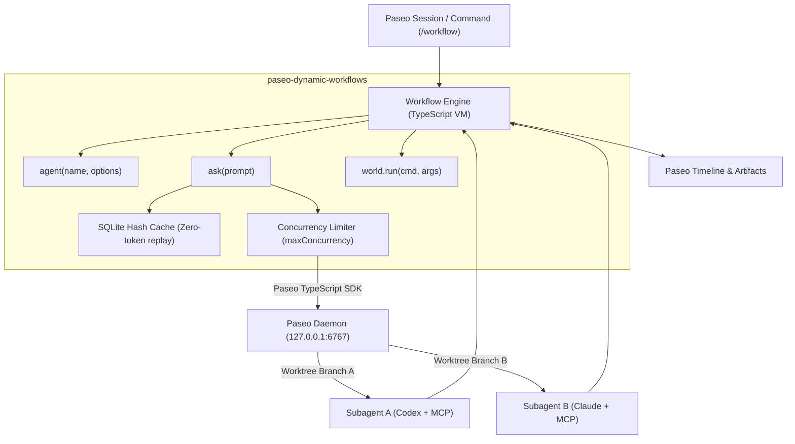

# Paseo Dynamic Workflows

> Dynamic Multi-Agent Workflow Orchestration for [Paseo](https://paseo.sh), ported from ZCode's Dynamic Workflow system.

**Paseo Dynamic Workflows** brings code-first multi-agent orchestration into Paseo. Instead of writing static YAML or brittle JSON configurations, you write pure **TypeScript** to orchestrate subagents, control concurrency, evaluate deterministic command gates, and cache intermediate results.

---

## Key Features

- **Workflow as Code (TypeScript DSL)**: Use standard `Promise.all()`, loops, and type assertions to orchestrate agents.
- **Git Worktree Isolation**: Subagents can run in independent Git worktrees (`isolation: "worktree"`), eliminating file-write race conditions and merge collisions.
- **Full MCP Tool Access**: Because each subagent runs through Paseo's native daemon/CLI, every subagent has access to all configured MCP servers (`git`, `agent-browser`, `context7`, etc.).
- **Heterogeneous Model Selection**: Different subagents in the same workflow can run on different providers (e.g. `claude/opus` for planning, `codex/gpt-5.4` for implementation, `codex/o3` for review).
- **Incremental Cache & Amend**: Every `ask()` result is indexed in SQLite by `(agentName, promptHash)`. Modifying a script and re-running it automatically replays previously completed steps at **0 tokens**.
- **Deterministic Gates (`world.run`)**: Loop termination and validation decisions are driven by actual command exit codes (e.g. `cargo test`, `pnpm test`), preventing hallucinations.
- **Plugin + Skill in One**: The plugin automatically injects the `dynamic-workflows` Skill into every Paseo agent at session creation, and symlinks it to `~/.agents/skills/dynamic-workflows`.

---

## Architecture Overview



---

## Installation

### 1. Install as a Paseo Local Plugin

```bash
# Clone the repository
git clone https://github.com/cathaysia/paseo-dynamic-workflows.git
cd paseo-dynamic-workflows

# Install dependencies
pnpm install

# Typecheck
pnpm typecheck

# Register plugin with Paseo
paseo plugin add .
```

### 2. Verify

In Paseo, open the **Workflows** icon on the sidebar, or type `/workflow` in any chat session.

---

## Quick Example: Fan-Out Code Review

Create a script named `.paseo/review-workflow.ts`:

```ts
interface ReviewFinding {
  path: string;
  severity: "low" | "medium" | "high";
  issue: string;
}

phase("Find changed files");
const filesToReview = await files.glob("src/**/*.ts");
log(`Found ${filesToReview.length} files to review`);

phase("Run parallel audits");
const results = await Promise.all(
  filesToReview.map((file) =>
    agent(`auditor-${file}`).ask<ReviewFinding[]>(
      `Audit ${file} for security vulnerabilities and race conditions. Return structured findings.`
    )
  )
);

const issues = results.flat();
report({ totalFiles: filesToReview.length, issuesCount: issues.length });

await artifact.markdown(
  "audit-report",
  `# Security Review Summary\n\nFound ${issues.length} potential issues across ${filesToReview.length} files.`
);

return { issues };
```

Run it directly in Paseo via slash command:
```bash
/workflow .paseo/review-workflow.ts
```

---

## Core API Reference

| Function / Context | Description |
|---|---|
| `agent(name, options)` | Creates or references a subagent. Options support `provider`, `system`, and `isolation: "worktree"`. |
| `agent.ask<T>(prompt)` | Sends prompt to subagent, parses JSON or text into type `<T>`, and caches result. |
| `world.run(cmd, args, opts)` | Runs local shell command; returns `{ exitCode, stdout, stderr }`. |
| `files.glob(pattern)` | Finds workspace files matching glob pattern. |
| `files.grep(pattern, filePattern)` | Searches workspace files for pattern with line citations. |
| `phase(title)` | Updates the current phase in timeline and telemetry. |
| `report(data)` | Emits structured live data for telemetry and UI. |
| `log(message)` | Prints runtime debug information. |
| `artifact.markdown(name, content)` | Writes a markdown deliverable under `.paseo/artifacts/`. |

---

## License

MIT
